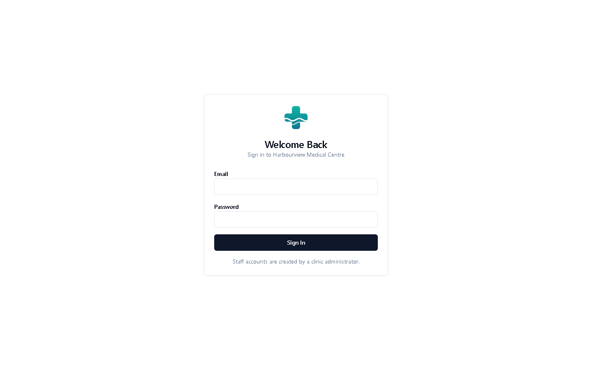
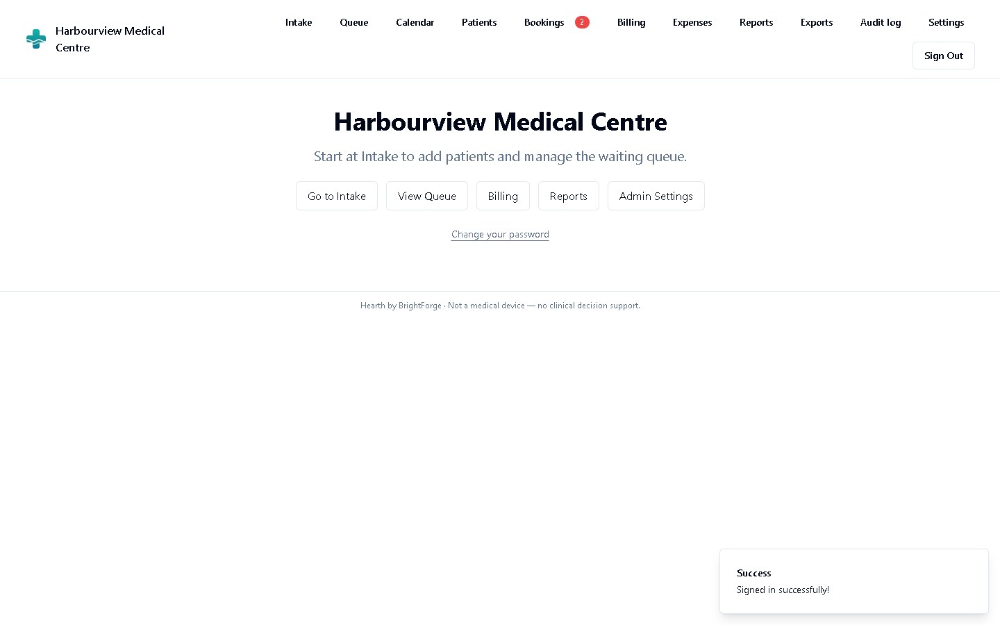
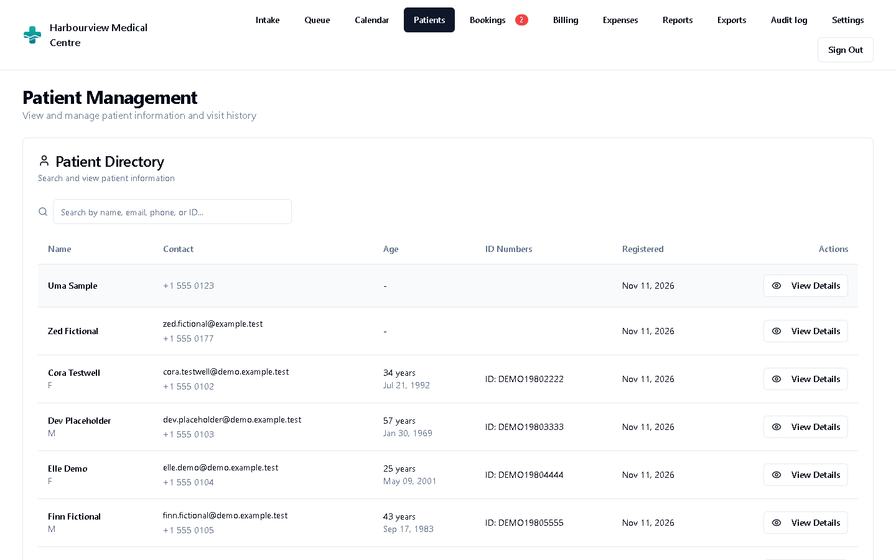
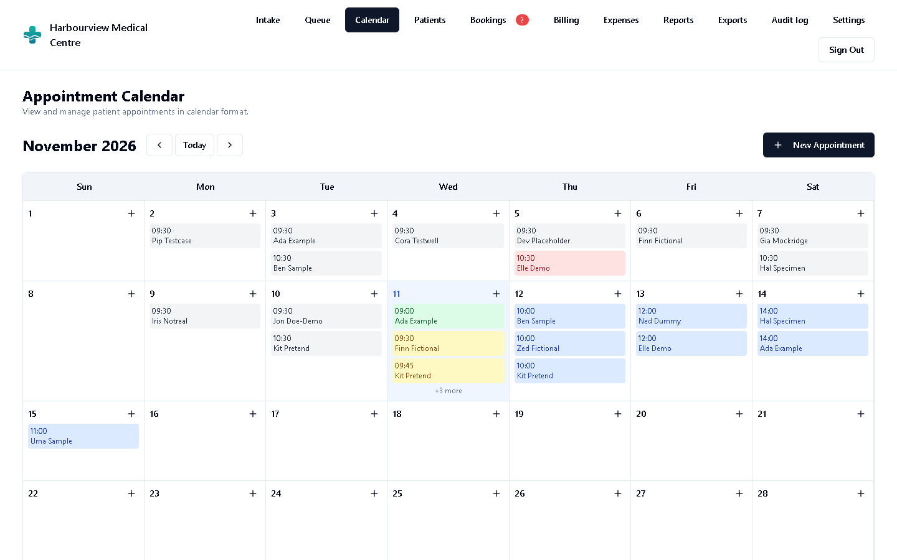
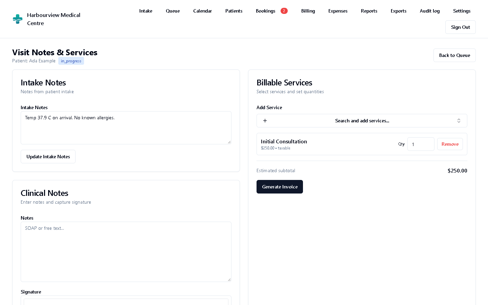
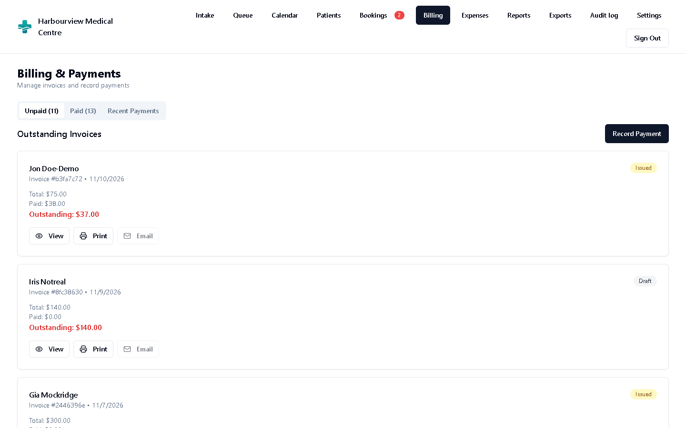
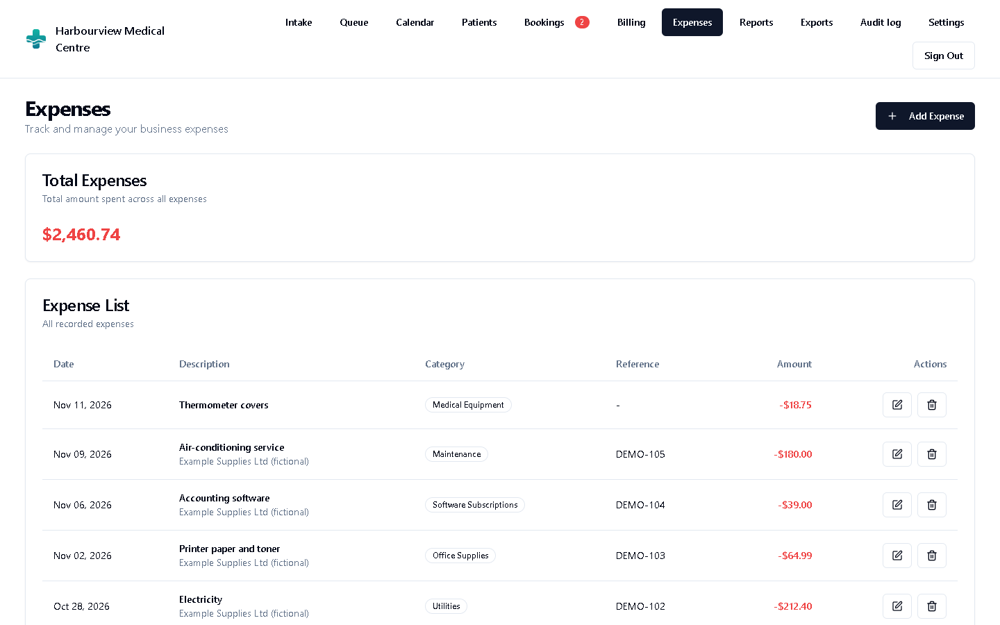
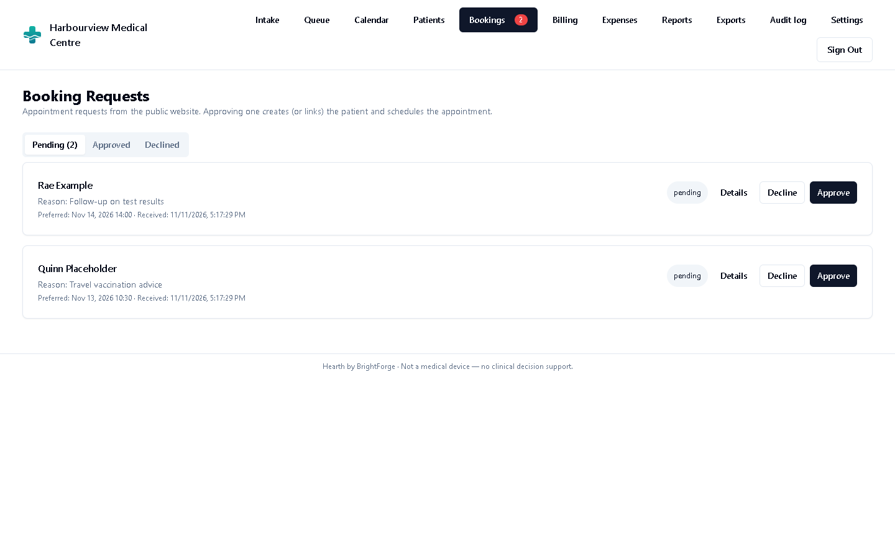
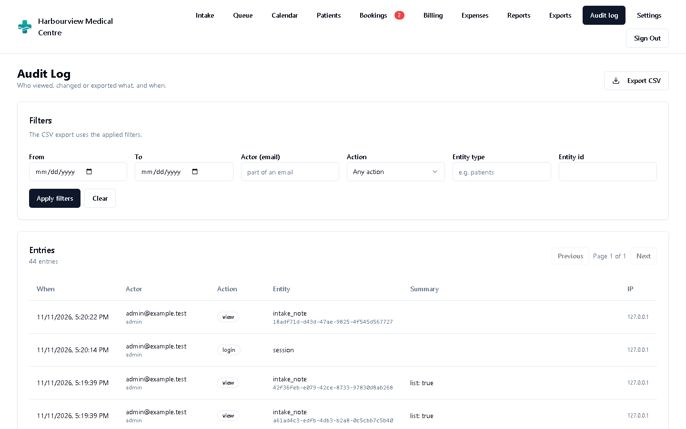

<div align="center">

# Hearth

**Practice management for the small clinic — patients, appointments, visit notes and billing in one place.**

Hearth by BrightForge is a free, open-source web app for small clinics with one
to five clinicians: family practices, specialist rooms, physiotherapy and
dental surgeries, community health centres. It runs as one Node.js process
next to a PostgreSQL database — on a small server, a back-office PC or in Docker.

[](LICENSE)
[](#requirements)
[](#requirements)
[](#roadmap)
[](https://github.com/brightforge-tech/hearth/actions/workflows/ci.yml)

[Features](#what-hearth-does) · [Screenshots](#screenshots) · [Quick start](#quick-start) · [Security](#security-and-privacy) · [For businesses](#for-businesses) · [Contributing](CONTRIBUTING.md)

</div>

---

> [!IMPORTANT]
> **Hearth is administrative software, not a medical device.** It records
> what clinic staff enter; it does not diagnose, recommend treatment, check
> doses or interactions, or give any other clinical decision support. The
> clinic that runs Hearth is responsible for how it is used and hosted, and
> for complying with the health-record and data-protection laws that apply to
> it. See [docs/PRIVACY-AND-SECURITY.md](docs/PRIVACY-AND-SECURITY.md).

## Why Hearth?

Small clinics are often stuck between paper, spreadsheets and practice
systems priced and built for hospital groups. Most need something plainer:
know who is coming in today, write the visit note, send the invoice, and know
who looked at which record.

- **One process, one database.** Node.js 20+ and PostgreSQL 13+. The API and
  the web app are served from the same port; migrations run on start-up.
- **Front desk to sign-off.** Intake, a live waiting-room queue, a calendar,
  signed visit notes and invoices — in the order a clinic day actually runs.
- **Accountable by default.** An append-only audit log records who viewed or
  changed patient records, and the database refuses to edit or delete it.
- **Private by default.** No e-mail, AI or other outside service is contacted
  unless you switch it on. Your data sits in your own database.
- **Yours.** Open source under the AGPL.

## What Hearth does

| Area | What you get |
|---|---|
| **Patients** | Patient register with contact details and identifiers, search, and each patient's visit history. |
| **Intake** | Check a patient in as a walk-in or for an appointment, with the reason for the visit and intake notes for the clinician. |
| **Queue** | Today's waiting room, updated live on every screen: waiting, in progress, done. |
| **Calendar** | Month view of appointments; book, reschedule and open appointments from the calendar, with working hours and default appointment length from the clinic settings. |
| **Visit notes** | Clinical notes per visit with the intake notes alongside, billable services picked during the visit, and an on-screen signature. Clinicians can be tagged as **Doctor**. |
| **Billing** | Invoices built from your service list, optional tax, part and full payments, printable invoices and receipts, and optional e-mailing of both. |
| **Expenses** | Record clinic spending by category; optionally scan a receipt photo to pre-fill the form with an AI model you choose. |
| **Reports** | Revenue summary, today's schedule and queue, and unpaid-invoice ageing. |
| **Exports** | CSV exports of invoices, payments and expenses in a QuickBooks-style layout, safe to open in a spreadsheet. |
| **Online booking** | A public landing page where patients can request an appointment. Requests wait for staff to approve or decline — nothing reaches the patient list on its own. |
| **Audit log** | Who viewed, created, changed, deleted or exported what, and every sign-in — filterable, with CSV export, for administrators. |
| **Users and roles** | Administrator, Billing/front office and Clinical staff roles plus a Doctor tag; temporary passwords must be changed at first sign-in. |
| **Settings** | Currency (default USD), tax name and rate (off by default), working hours, services and prices. |

## Screenshots

| | |
|---|---|
|  |  |
| **Sign in** — staff accounts only, no public sign-up | **Dashboard** — shortcuts to intake, queue, billing and reports |
|  |  |
| **Patients** — search, details and visit history | **Calendar** — the month's appointments at a glance |
|  |  |
| **Visit** — intake notes, clinical notes and signature | **Billing** — invoices, payments and receipts |
|  |  |
| **Expenses** — categories, optional receipt scan | **Booking requests** — approve or decline online requests |

<p align="center"><br><b>Audit log</b> — who did what, when, from where</p>

*Screens show the fictional demo clinic from `scripts/demo-data.mjs`. No real patient data.*

## Quick start

### Requirements

Node.js **20 or later** (CI uses 22) · PostgreSQL **13 or later** (tested on 17) ·
or Docker with Compose.

### Option 1 — Docker

```bash
git clone https://github.com/brightforge-tech/hearth.git
cd hearth
cp .env.example .env    # set POSTGRES_PASSWORD, JWT_SECRET and the SEED_* accounts
docker compose up -d --build
docker compose logs app # "api: listening on ..." once migrations and seeding are done
```

Open <http://localhost:8787> and go to **Staff sign-in**. Sign in with the
`SEED_ADMIN_EMAIL` / `SEED_ADMIN_PASSWORD` from your `.env`; you will be asked
to choose a new password straight away. The database is not published to the
host, and the app listens on `127.0.0.1` only — put an HTTPS reverse proxy in
front of it to serve your clinic's network ([docs/DEPLOYMENT.md](docs/DEPLOYMENT.md)).

To try it with the fictional demo clinic:

```bash
docker compose exec app node scripts/demo-data.mjs
```

### Option 2 — Node.js and PostgreSQL

```bash
git clone https://github.com/brightforge-tech/hearth.git
cd hearth
npm ci
cp .env.example .env    # set DATABASE_URL, JWT_SECRET and the SEED_* accounts
createdb hearth         # or: npm run db:init
npm run build           # builds the web app into dist/
npm start               # http://127.0.0.1:8787
```

On start-up Hearth connects to the database, applies any new migrations from
`db/migrations/`, creates the admin and staff accounts from `SEED_*` if they
do not exist yet, and then serves the API under `/api` and the web app on the
same port. `GET /healthz` answers `200` once it is ready. Optional demo data:
`node scripts/demo-data.mjs` (`--reset` or `--remove` to undo it).

For development with hot reload, run `npm start` and `npm run dev` side by
side — see [CONTRIBUTING.md](CONTRIBUTING.md).

### Running the tests

```bash
# needs a reachable PostgreSQL; the tests use <your database>_test and reset it
npm test
```

The runner only ever wipes a database whose name ends in `_test`, and writes a
JUnit report to `reports/junit.xml`.

## Configuration

Hearth is configured entirely through environment variables; a `.env` file in
the project root is read at start-up. [`.env.example`](.env.example) lists
them all. More detail: [docs/CONFIGURATION.md](docs/CONFIGURATION.md).

| Variable | Default | What it does |
|---|---|---|
| `DATABASE_URL` | — | PostgreSQL connection string. Or set `PGHOST`, `PGPORT`, `PGDATABASE`, `PGUSER`, `PGPASSWORD`. |
| `JWT_SECRET` | — (**required**) | Long random secret that signs session tokens. Without it, nobody can sign in. |
| `PORT` | `8787` | Port for the API and the web app. |
| `HOST` | `127.0.0.1` | Address to bind. Use `0.0.0.0` in Docker (the image sets it). |
| `ALLOWED_ORIGINS` | — | Comma-separated browser origins allowed by CORS, e.g. `https://clinic.example.com`. Never `*`. |
| `APP_BASE_URL` | — | Public URL of your install; used in password-reset links. |
| `UPLOAD_DIR` | `var/uploads` | Where signatures and other uploads are stored (`/data/uploads` in Docker). |
| `CLINIC_NAME` | demo name | Clinic name used by the API, e.g. in e-mails. |
| `VITE_CLINIC_NAME`, `VITE_CLINIC_SHORT_NAME`, `VITE_CLINIC_PHONE`, `VITE_CLINIC_EMAIL`, `VITE_CLINIC_ADDRESS`, `VITE_CLINIC_HOURS` | demo clinic | Shown on the public landing page. **Build-time:** set them before `npm run build` / `docker compose build`. |
| `SESSION_IDLE_MINUTES` | `30` | Sign out after this long without activity. |
| `SESSION_MAX_HOURS` | `12` | Sign out after this long regardless of activity. |
| `LOGIN_MAX_FAILURES` | `5` | Failed sign-ins per account before a lockout (1, 2, 4 … up to 60 minutes). |
| `LOGIN_IP_MAX_FAILURES` | `20` | Failed sign-ins per IP address in 15 minutes before it is blocked. |
| `BOOKING_RATE_LIMIT_PER_HOUR` | `5` | Online booking requests accepted per IP address per hour. |
| `ALLOW_SELF_SIGNUP` | off | Leave off. Staff accounts are created by an administrator. |
| `SEED_ADMIN_EMAIL`, `SEED_ADMIN_PASSWORD` | `admin@example.test` | First administrator, created once if missing. |
| `SEED_STAFF_EMAIL`, `SEED_STAFF_PASSWORD` | `staff@example.test` | First clinical staff account, created once if missing. |
| `SEED_FORCE_PASSWORD_CHANGE` | on | Seeded accounts must choose a new password at first sign-in. |
| `TRUST_PROXY` | loopback + private networks | Which reverse proxies may set `X-Forwarded-For` (used for throttling and the audit log). `false` trusts none. |
| `RESEND_API_KEY` | unset (e-mail off) | Turns on e-mail through [Resend](https://resend.com): invoices, receipts and password-reset links. |
| `RESEND_FROM_INVOICE`, `RESEND_FROM_RECEIPT`, `RESEND_FROM_SYSTEM` | — | Verified sender addresses for invoices, receipts and password-reset mails. |
| `RECEIPT_AI_API_KEY` | unset (scanning off) | Turns on expense receipt scanning. |
| `RECEIPT_AI_BASE_URL` | `https://api.openai.com/v1` | Any OpenAI-compatible endpoint, including a model server on your own network. |
| `RECEIPT_AI_MODEL` | `gpt-4o-mini` | Vision-capable model name for receipt scanning. |

Currency and tax are set in the app under **Settings** (default USD, tax off).

## Security and privacy

Hearth holds health records, so it is careful by default:

- **Audit log.** Every change to patients, appointments, notes, invoices,
  payments, expenses, booking requests, users, roles and settings, every
  export, every sign-in (and failed attempt), and every opening of a patient
  record, visit note or intake note is recorded: who, role, action, record,
  time and IP, plus the *names* of changed fields — never their values. A
  database trigger blocks any update or deletion of audit rows.
- **Sign-in hardening.** Throttling per account and per IP, kept in the
  database, with growing lockouts. Server-side sessions with an idle timeout
  and an absolute lifetime, a new session on every sign-in, and revocation on
  sign-out and password change. scrypt password hashing; passwords of at
  least 12 characters that are not all digits, not a common password and not
  the e-mail address.
- **Password resets.** Administrators issue a temporary password that must
  be changed. Self-service reset by e-mail exists only when e-mail is
  configured; links are single-use, expire after one hour and are stored
  hashed.
- **Safe online booking.** The public form creates a booking *request*, never
  a patient or appointment, and returns no data. It is rate-limited per IP,
  length-capped and has a honeypot field.
- **Access control in the API.** Every role check is enforced on the server,
  not just hidden in the web app. CORS is an explicit allow-list. CSV exports
  neutralise spreadsheet formulas.
- **No outside calls unless you enable them.** E-mail (Resend) and receipt
  scanning (your chosen AI provider) are off until you set their keys.

Hearth does not use PostgreSQL row-level security: **the database must be
reachable only by the Hearth server.** Always serve Hearth over HTTPS, encrypt
disks and backups, and test restores. What is stored, what is logged, hosting
and retention guidance and the known limitations are in
**[docs/PRIVACY-AND-SECURITY.md](docs/PRIVACY-AND-SECURITY.md)**; reverse
proxy and backup recipes in **[docs/DEPLOYMENT.md](docs/DEPLOYMENT.md)**.
Found a vulnerability? Please read [SECURITY.md](SECURITY.md) and report it
privately.

## For businesses

Hearth is free and open source. BrightForge Technologies also offers:

- **Managed hosting** — we run Hearth for you on a secure server with HTTPS,
  encrypted backups, monitoring and updates, so your clinic only needs a
  browser.
- **Setup and data migration** — we install and configure Hearth, set up your
  services, prices, users and roles, and bring in your existing patient and
  billing records from spreadsheets or your old system.
- **Custom integrations** — insurers and claims, laboratories, SMS appointment
  reminders, accounting systems, an edition tailored to your specialty.
- **Support plans** — priority fixes, upgrades and help for your staff.
- **Commercial licence** — for companies that want to build Hearth into a
  product or service without the AGPL's source-sharing terms.

Contact: [info@brightforgett.com](mailto:info@brightforgett.com) · [brightforgett.com](https://brightforgett.com)

## Roadmap

- Two-factor sign-in
- SMS and e-mail appointment reminders
- Patient portal
- Prescriptions
- Lab orders and results
- FHIR / HL7 interoperability
- Field-level encryption for clinical notes
- Several clinics or branches in one install

Not planned: anything that gives clinical advice or decision support. Have an
idea? Open a [discussion](../../discussions).

## Contributing

Contributions are welcome — bug reports, translations, docs and code. Please
read [CONTRIBUTING.md](CONTRIBUTING.md). **Never put real patient data in an
issue, pull request, test fixture or screenshot.** Code contributions need a
one-time sign-off of our [Contributor Licence Agreement](CLA.md).

Hearth is part of **BrightForge Labs**, the open-source arm of BrightForge
Technologies.

## Licence

Hearth is licensed under the **GNU Affero General Public License v3.0** — see
[LICENSE](LICENSE). In short: you can use, study, change and share Hearth
freely, including to run your own clinic; if you distribute a modified version
or offer it to others over a network, you must share your source code under
the same licence. For other terms, see [For businesses](#for-businesses).

Hearth is provided without warranty of any kind (sections 15 and 16 of the
licence).

"Hearth by BrightForge" and "BrightForge" are names of BrightForge Technologies
Limited. Third-party notices are in [NOTICE](NOTICE).

---

<div align="center">

<a href="https://brightforgett.com">
  <picture>
    <source media="(prefers-color-scheme: dark)" srcset=".github/assets/brightforge-logo-dark.png">
    
  </picture>
</a>

**Shaping Innovation, Forging the Future**

[brightforgett.com](https://brightforgett.com) · [info@brightforgett.com](mailto:info@brightforgett.com)

</div>
